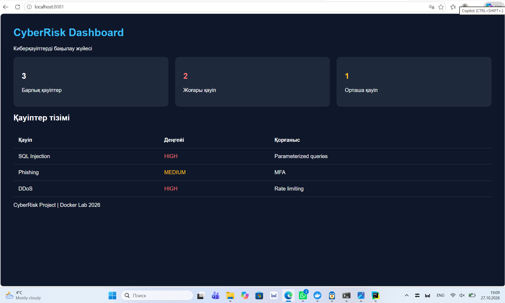
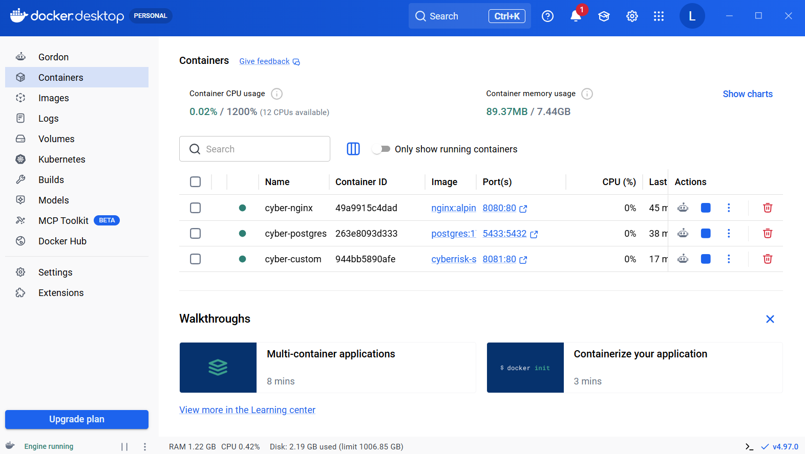

# CyberRisk Docker Project

СРО №3 — Киберриск

## Project Description

This project demonstrates Docker containerization using three services:

1. **Nginx** — Web server
2. **PostgreSQL** — Database server
3. **CyberRisk Dashboard** — Custom HTML/CSS cybersecurity website

## Docker Containers

| Container | Image | Port |
|---|---|---|
| cyber-nginx | nginx:alpine | 8080 |
| cyber-postgres | postgres:17 | 5433 |
| cyber-custom | cyberrisk-site:v1 | 8081 |

## Build Custom Docker Image

```bash
docker build -t cyberrisk-site:v1 .
```

## Run Custom Website



```bash
docker run -d --name cyber-custom -p 8081:80 cyberrisk-site:v1
```

Open http://localhost:8081

## Docker Hub Images




